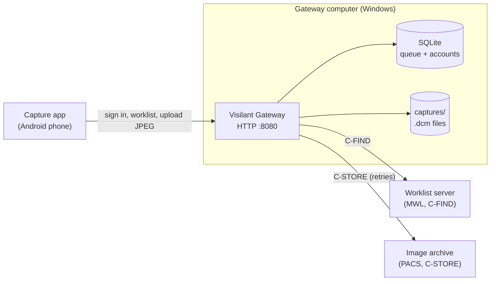

# Visilant Gateway

The Visilant Gateway is a small on-premises service that connects the Visilant eye-capture
app to a hospital's DICOM systems. It runs on one Windows computer inside the hospital
network and needs no internet connection.

It does three things:

1. **Reads the worklist.** It asks the hospital's DICOM Modality Worklist (MWL) server which
   patients are scheduled, using a DICOM C-FIND query, and gives that list to the phone.
2. **Receives photographs.** The phone uploads each eye photograph with the worklist order it
   belongs to. The gateway turns the JPEG into a DICOM Ophthalmic Photography object at once
   and saves it to local disk.
3. **Sends to the PACS.** A background worker sends each DICOM file to the hospital archive
   (PACS) with C-STORE. It retries with back-off, and after `max_send_attempts` failures it
   marks the photograph `FAILED` for an operator to retry.



This repository holds **only the gateway**. The capture app and its AI models are not
included. The gateway accepts an optional AI result that the app sends with a photograph,
checks its format and stores it in a private DICOM tag. It does not run any model.

## Get started

Everything runs on **Windows 10 or 11, 64-bit**. You need **Git** and **Node 22** (not 24).
Then, in PowerShell:

```powershell
git clone https://github.com/Visilant/visilant-gateway-aravind-public.git
cd visilant-gateway-aravind-public
powershell -NoProfile -ExecutionPolicy Bypass -File .\windows\setup.ps1
```

The setup command downloads DCMTK and ImageMagick, builds the gateway, installs it and
opens the **setup wizard** in your browser. In the wizard you enter your worklist and PACS
details and create an account. Then you sign in with that account on the phone.

**Follow [docs/windows-setup.md](docs/windows-setup.md).** It walks through every step,
including what to ask for before you start and what to type in each box of the wizard.

## Learn the system

[docs/README.md](docs/README.md) lists the documents in the order to read them, and the
six rules every developer must know before changing anything.

| If you want to... | Read |
|---|---|
| Install the gateway and connect the phone | [docs/windows-setup.md](docs/windows-setup.md) |
| Fix a problem | [docs/troubleshooting.md](docs/troubleshooting.md) |
| Understand how the code is organised | [docs/architecture.md](docs/architecture.md) |
| Change which patients the phone sees (procedure ID, modality, station) | [docs/worklist.md](docs/worklist.md) |
| Change what goes into the DICOM file or how it reaches the PACS | [docs/dicom-output.md](docs/dicom-output.md) |
| See every `config.json` setting | [docs/configuration.md](docs/configuration.md) |
| Run from source, run tests, make a change | [docs/development.md](docs/development.md) |
| See the HTTP API that the phone uses | [docs/api.md](docs/api.md) |
| See how the Aravind installation is set up | [docs/aravind-deployment.md](docs/aravind-deployment.md) |
| Follow the coding rules for this repository | [CONTRIBUTING.md](CONTRIBUTING.md) |

## Commands

For working on the code. Run them in PowerShell from the repository folder.

| Command | What it does |
|---|---|
| `npm run dev` | Run the gateway from source (needs a `config.json`, see [development.md](docs/development.md)) |
| `npm run build` then `npm start` | Compile to `build/` and run the compiled gateway |
| `npm run typecheck` | Type-check without building |
| `npm test -- --runInBand` | Unit and integration tests. `$env:TEST_DCMTK = '1'` first also runs the tests that call real DCMTK |
| `npm run e2e` | End-to-end test against a local test PACS in Docker |
| `npm run check` | Typecheck, test and build: run this before you push |
| `npm run users -- add <email> <username> [--admin]` | Create an account (prints a generated password once) |
| `npm run users -- passwd <email>` | Reset a password |
| `npm run migration:generate -- migrations/Name` | Generate a database migration from an entity change |
| `npm run setup` | Run the setup wizard from source |

`GET /health` checks the database, the queue, free disk space, and sends a DICOM C-ECHO to
both servers. It returns `200` when everything works and `503` when something does not,
with a `detail` on the check that failed.

## Technology

TypeScript on Node 22. HTTP with routing-controllers and Express, dependency injection with
TypeDI, validation with class-validator, database with TypeORM over SQLite
(better-sqlite3). The DICOM work is done by the DCMTK command-line tools (`findscu`,
`img2dcm`, `storescu`, `echoscu`, `dcm2json`, `dcmdump`, `dcmodify`) and ImageMagick
(`magick`).

## Patient data

The worklist, the uploaded photographs and the `.dcm` files contain patient data. Patient
data stays in the `.dcm` files on disk. It must never go into the database, the logs or Git.
`config.json`, `data/` and `captures/` are runtime files and are ignored by Git. See
[CONTRIBUTING.md](CONTRIBUTING.md#patient-data-phi).

## License

[MIT](LICENSE) © 2026 Visilant
