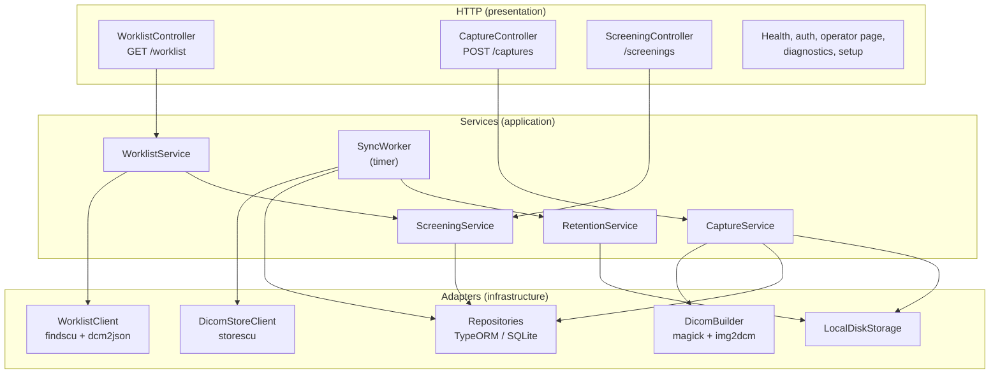
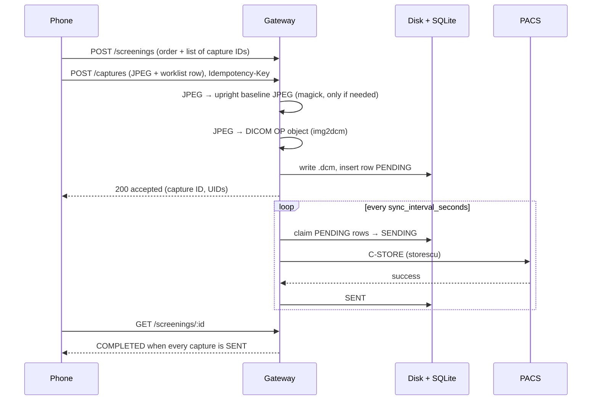
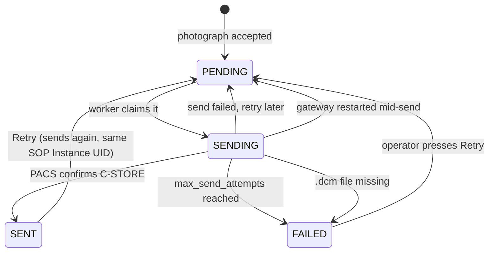

# Architecture

This page explains how the gateway is built, so that you can find the code for any
behaviour and know where a change belongs.

## The big picture

The gateway is one Node.js process. It has an HTTP server for the phone and a background
worker for the PACS. Both use the same SQLite database. All DICOM network work and file
conversion is done by calling the DCMTK and ImageMagick command-line tools.

## Layers

The code follows **controller → service → repository**. Keep to it when you add code.

| Layer | Folder | Does | Does not |
|---|---|---|---|
| Controller | `src/presentation/controllers/` | Receives the HTTP request, gets a validated DTO, calls one service, returns the result | Contain business rules or touch the database |
| Service | `src/application/services/` | All business rules: what to query, what to store, when to retry | Know about HTTP |
| Repository | `src/infrastructure/database/repositories/` | Read and write one table | Decide anything |
| DICOM adapters | `src/infrastructure/dicom/` | Run the DCMTK tools and report what they said | Decide anything |

Classes get their dependencies through the constructor (TypeDI injects them by type). Three
values are made at start-up and injected by token instead: the config, the logger and the
database (`src/tokens.ts`).

## Folder map

| Path | What is there |
|---|---|
| `src/index.ts` | Start-up: load config, open the database and run migrations, recover interrupted sends, start the HTTP server and the timers |
| `src/config/` | `config.json` schema and loader. The process will not start with an invalid config |
| `src/domain/assessment.ts` | Format of the optional AI result that the phone sends |
| `src/application/dto/` | Request and response shapes, with validation rules |
| `src/application/services/` | Business logic (see below) |
| `src/infrastructure/dicom/` | Worklist query, DICOM file build, C-STORE, C-ECHO, DICOM tag and code constants |
| `src/infrastructure/database/` | Entities, repositories, TypeORM data source |
| `src/infrastructure/storage/` | Where `.dcm` files are written on disk |
| `src/infrastructure/image/jpeg.ts` | Reads the JPEG header (baseline or progressive, EXIF rotation) |
| `src/infrastructure/diagnostics/` | Optional timing recorder used for performance investigation |
| `src/presentation/` | HTTP server, controllers, error handling, the operator web page (`ui/`) |
| `src/setup/` | Windows setup wizard on port 8081 and the launcher that supervises the gateway |
| `src/cli/manage-users.ts` | `npm run users` |
| `migrations/` | Generated database migrations. They run automatically at start-up |
| `windows/` | PowerShell scripts: `setup.ps1` (one command from a clone to the setup wizard), and the scripts that build, install and run the Windows bundle |
| `dev/` | Local test PACS, worklist seeding, end-to-end test |
| `tests/` | Jest tests |

### Services

| Service | Responsibility |
|---|---|
| `WorklistService` | Runs the C-FIND, turns each response into a worklist row, drops rows that cannot be used, hides orders that are already complete |
| `CaptureService` | Accepts one photograph: checks it against its screening, works out the series and UIDs, builds the DICOM file, adds a `PENDING` row |
| `ScreeningService` | A *screening* is the set of photographs for one order. It tracks when every photograph is in the PACS (`COMPLETED`) and lets an operator release a screening that cannot finish |
| `SyncWorker` | Every `sync_interval_seconds`, sends `PENDING` captures to the PACS, with exponential back-off |
| `RetentionService` | After delivery, deletes old `.dcm` files according to `retention` |
| `ScreeningExpiry` | Releases screenings that have had no activity for `screening_expiry_days` |
| `HealthService` | `GET /health` |
| `AuthService`, `SecretService` | Sign-in, JWT tokens, signing secrets stored in SQLite |
| `DicomPreviewService` | Preview image and tags for the operator page |
| `SetupVerificationService` | Records the steps of the setup wizard |

## A worklist request

1. The phone calls `GET /worklist`.
2. `WorklistService` asks `WorklistClient` for the worklist. The client runs `findscu -W`
   with the configured filters and writes each response to a temporary folder.
3. Each response file is converted to JSON with `dcm2json`, and the folder is deleted.
4. Each response becomes one row per scheduled step. Rows without an accession number or
   a patient ID are dropped and counted in the log.
5. `ScreeningService` removes orders that already have a completed screening and adds the
   delivery status of any screening in progress.
6. The rows go back to the phone. Nothing from the worklist is stored.

Details: [worklist.md](worklist.md).

## A photograph

Important points:

- The DICOM file is built **when the photograph arrives**, not when it is sent. The patient
  details from the worklist go into the file and never into the database. A retry is just
  a resend of a finished file.
- The phone sends an `Idempotency-Key` with every upload. A repeat returns the first result,
  so a network retry never makes a second image.
- "Accepted" (HTTP 200 from `POST /captures`) only means the file is saved on the gateway. Only a successful
  C-STORE makes a capture `SENT`.

Details: [dicom-output.md](dicom-output.md).

## Capture states

Retry does not reset the attempt count. A capture that reached `max_send_attempts` gets
one more attempt per Retry.

## Built for an unattended computer

Nobody watches the gateway computer. The design assumes power cuts, a PACS that is away for
hours and no one on site to fix things.

- Everything that matters is in SQLite. Nothing important is kept only in memory.
- At start-up, rows left in `SENDING` go back to `PENDING`.
- A `.dcm` file is never deleted before the PACS has confirmed it.
- Database migrations run at start-up and must be safe to run on a centre's existing data.
- Error messages must say what failed and what to do, because the log is the only
  diagnosis anyone gets.
